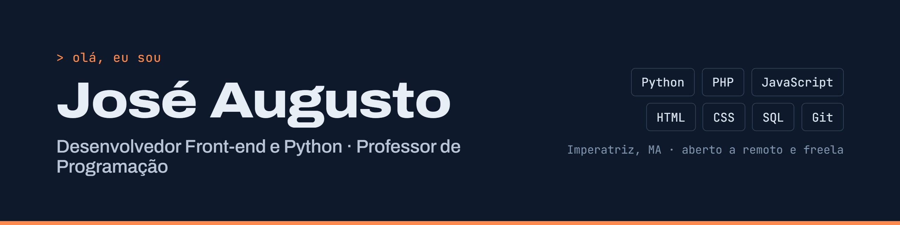

## Olá, eu sou o José Augusto 👋

Desenvolvedor formado em **Análise e Desenvolvimento de Sistemas** e professor de programação front-end e computação gráfica no ensino técnico, em Imperatriz (MA).

Gosto de criar sites e de automatizar tarefas repetitivas com Python. Antes da programação, trabalhei com suporte de TI, manutenção de computadores e produção de vídeo, então também cuido bem da parte visual dos projetos.

📫 Aberto a vagas remotas, projetos freelance e oportunidades presenciais em Imperatriz.

---

### 🛠️ Tecnologias

**Linguagens:** Python · PHP · JavaScript · HTML · CSS · SQL
**Ferramentas:** Git · Linux · VS Code · PyCharm · IntelliJ · XAMPP
**Design e vídeo:** Photoshop · Premiere · After Effects

---

### 🚀 Projetos em destaque

| Projeto | O que faz | Tecnologias |
|---|---|---|
| [Gerador de Provas](https://github.com/JoseArraes/gerador-de-provas) | Cria provas online, corrige automaticamente e guarda as notas da turma. Em uso nas minhas aulas | JavaScript, PHP, MySQL |
| [TV Digital](https://github.com/JoseArraes/tv-digital) | Painel para exibir imagens e vídeos em loop nas TVs de uma empresa | PHP, JavaScript |
| [Cortador de Shorts](https://github.com/JoseArraes/cortador-de-shorts) | Transforma vídeos horizontais em cortes verticais para Shorts e TikTok | Python, ffmpeg |
| [Gerador de Cartelas](https://github.com/JoseArraes/gerador-de-cartelas) | Gera dezenas de cartelas numeradas de uma vez, encaixadas numa arte pronta | Python, Pillow |
| [Cadastro de Ninjas](https://github.com/JoseArraes/CadastroDeNinjas) | API de cadastro com Spring Boot | Java, Spring Boot |

---

### 📬 Contato

